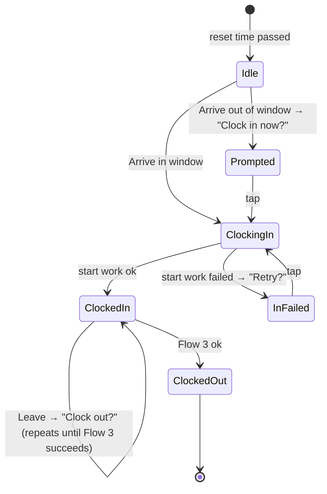

# location-trigger — Architecture

- Status: Accepted
- Date: 2026-10-25
- Platform: iPhone (iOS 17 or later), iOS Shortcuts and Scriptable

## Goal

Clock in to the company ERP when the phone arrives at the office, and make clocking out a
single tap after it leaves. Today both are done by hand on the ERP website.

Everything runs on the phone. There is no server, and no app to build or sign.

## Flows

| Flow | Trigger | Guard | Action | Notification |
|---|---|---|---|---|
| 1 (auto) | Arrive | inside the time window, Flow 1 not started today | sign in, **start work** | result |
| 4 | Arrive | outside the time window, Flow 1 not started today | none | "Clock in now?" → tap runs Flow 1 |
| 1 (manual) | tap, or run `ClockIn` | Flow 1 not succeeded today | sign in, **start work** | result |
| 2 | Leave | Flow 1 succeeded, Flow 3 not succeeded, at least N minutes since the last Arrive | none | "Clock out?" → tap runs Flow 3 |
| 3 | tap, or run `ClockOut` | none | sign in, **end work** | result |

The time window (for example 08:00–10:00), the daily reset time (default 00:00) and the
exit grace period N (default 5 minutes) are settings.

## Components

| Component | What it is | Responsibility |
|---|---|---|
| Arrive automation | Shortcuts personal automation, "Arrive", Run Immediately | runs the `Arrive` script |
| Leave automation | Shortcuts personal automation, "Leave", Run Immediately | runs the `Leave` script |
| `Arrive`, `Leave`, `ClockIn`, `ClockOut` | Scriptable scripts | read state, ask `lib/state` what to do, run it, notify |
| `Setup` | Scriptable script | enters and validates the settings and the password |
| `lib/state.js` | pure JS | daily state, reset, guards; the only code that changes flow state |
| `lib/keycloak.js` | pure JS | reads the Keycloak login form and builds the sign-in request |
| `lib/storage.js` | JS over Scriptable's `FileManager` and `Keychain` | settings, state and password |
| `lib/erp.js` | JS over Scriptable's `Request` | sign-in, start work, end work (pending: see Open items) |

`lib/` modules use `module.exports`, so Scriptable's `importModule()` and Node's `require()`
load the same file, and everything in `lib/` is tested with `node --test`. Scriptable APIs
reach `lib/` only as parameters.

The geofence is the location set in each automation. Use a radius of 150 m or more: iOS
region monitoring is coarse, and events can arrive minutes late.

## Daily state

Kept in a JSON file in Scriptable's local documents folder.

| Key | Values | Meaning |
|---|---|---|
| `flow1` | `none`, `running`, `ok`, `failed` | today's clock-in |
| `flow3` | `none`, `running`, `ok`, `failed` | today's clock-out |
| `lastResetAt` | time | when the flags were last cleared |
| `lastEnterAt` | time | the last Arrive, for the exit grace period |

### Rules

- **Lazy reset.** Before any guard, compute the most recent reset boundary: the reset time
  today, or yesterday if today's has not passed yet. If it is later than `lastResetAt`,
  set `flow1` and `flow3` to `none` and `lastResetAt` to now. No timer is needed.
- **Reset outside the window.** `Setup` rejects a reset time strictly inside the window,
  so a window that crosses midnight (22:00–04:00) is never split.
- **Mark before running.** A flow is set to `running` and saved *before* the ERP is called,
  so a second Arrive cannot clock in twice.
- **Automatic runs only from `none`.** Arrive starts Flow 1 only when `flow1` is `none`.
  A manual Flow 1 runs from `none`, `running` or `failed`: a run that iOS killed halfway
  stays `running`, and the user can always retry it. It refuses only `ok`.
- **Flow 2 needs a successful clock-in.** It fires on Leave only when `flow1` is `ok` and
  `flow3` is not `ok`, and repeats on every such Leave, as a reminder.
- **Exit grace period.** A Leave within N minutes of `lastEnterAt` is ignored, so a GPS
  bounce right after arriving cannot fire Flow 2. A real exit in that time is dropped;
  `ClockOut` can still be run by hand.
- **Flow 4 covers early arrivals.** iOS fires Arrive once per crossing, so arriving before
  the window and staying inside never auto-runs Flow 1. The prompt hands that day to the user.

## Signing in

The ERP signs in through Keycloak (OpenID Connect) with a confidential client: the ERP's
server holds the client secret and exchanges the code. The password grant is refused
(`unauthorized_client`), and a client of our own would need the company's Keycloak admin.

So the scripts replay what the browser does:

1. GET the ERP's sign-in URL and follow redirects to the Keycloak login page.
2. Read `#kc-form-login`: its `action` URL and hidden inputs (`lib/keycloak.js`).
3. Check the action URL is `https` on the configured Keycloak host, then POST the
   username and password to it. The password is never sent anywhere else.
4. Follow redirects back to the ERP, which sets its session.
5. Call start work or end work with that session, sending the phone's current position
   (Scriptable `Location.current()`), never the configured office location.

This needs no secret. It breaks if the login page changes shape or gains MFA or a captcha;
the flow then ends as `failed` with a "Sign-in failed" notification, and the user clocks in
on the website as before. If the company later provides a public PKCE client with
`offline_access`, only `lib/erp.js` changes.

## Storage and notifications

- **Settings**: ERP sign-in URL, Keycloak host, username, window, reset time, grace period,
  in a JSON file in Scriptable's local documents folder (`FileManager.local()`).
- **Password**: the iOS Keychain through Scriptable's `Keychain`. Never in a file.
- **State**: the JSON file above, read fresh on every run.
- **Notifications**: Scriptable `Notification`. Each flow has a fixed identifier, so a
  repeat replaces the previous one. Taps use `openURL` to run a script, for example
  `scriptable:///run/ClockOut`.

## Public repository

The repository is public. No company URL, host, username, password, coordinates or captured
request is committed: all of them are entered in `Setup` on the phone. Fixtures use
`example.com`.

## Open items

| Item | Needed for | Status |
|---|---|---|
| ERP sign-in redirects and session (cookie or token) | `lib/erp.js` | waiting for a scrubbed DevTools capture |
| Start work and end work requests (method, path, body, location fields) | `lib/erp.js` | waiting for the capture |
| A Run Immediately location automation fires while the phone is locked | Flows 1, 2, 4 | to check with `scripts/Spike.js` |
| Scriptable's `Request` keeps Keycloak cookies across the redirects | signing in | to check with `scripts/Spike.js` |
| `Location.current()` returns a fix when run from an automation | start and end work | to check with `scripts/Spike.js` |
